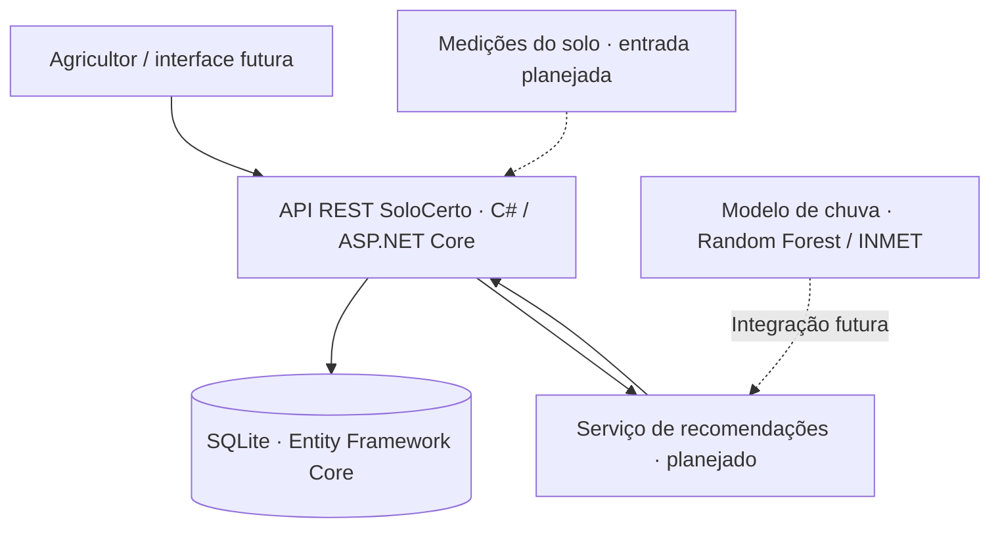

# 🌱 SoloCerto — API de Apoio à Irrigação Inteligente

**Global Solution FIAP 2026.2 · CitizenTech · C# Software Development**

> Uma solução pensada para apoiar pequenos produtores rurais no uso consciente da água, combinando informações de umidade do solo, dados meteorológicos e recomendações de irrigação.

**Status:** 🚧 Em desenvolvimento — este README apresenta a visão completa do projeto e diferencia as funcionalidades já implementadas das previstas.

## 1. Equipe

| Integrante                         | RM         |
| ---------------------------------- | ---------- |
| **Igor Brunelli Ralo**             | **555035** |
| **José Antonio Kretzer Rodriguez** | **555523** |
| **Victor Mattenhauer Lopes Capp**  | **555753** |

## 2. Ficha da CitizenTech

| Item                                     | Descrição                                                                                                                                                                     |
| ---------------------------------------- | ----------------------------------------------------------------------------------------------------------------------------------------------------------------------------- |
| **Nome**                                 | SoloCerto                                                                                                                                                                     |
| **Local de referência**                  | Campinas (SP) e região; o projeto não está restrito a um bairro específico                                                                                                    |
| **Cidadão beneficiado**                  | Pequenos produtores rurais que precisam decidir quando irrigar suas plantações                                                                                                |
| **Problema**                             | Irrigar sem considerar a umidade real do solo e a possibilidade de chuva pode desperdiçar água; adiar a irrigação sem informação também pode prejudicar o cultivo             |
| **Solução proposta**                     | Centralizar o cadastro das áreas de cultivo, registrar umidade do solo, apresentar informações sobre chuva e oferecer recomendações de irrigação                              |
| **Parte desenvolvida neste repositório** | Backend REST em C#/.NET, com persistência de dados e regras de negócio                                                                                                        |
| **Parte de IA**                          | Modelo de classificação de chuva nas próximas 24 horas, desenvolvido em repositório separado                                                                                  |
| **Indicador de impacto futuro**          | Quantidade e proporção de recomendações que permitam evitar irrigações potencialmente desnecessárias, a serem avaliadas em testes de uso                                      |
| **ODS relacionados**                     | ODS 2 — Fome Zero e Agricultura Sustentável; ODS 9 — Indústria, Inovação e Infraestrutura; ODS 10 — Redução das Desigualdades; ODS 13 — Ação Contra a Mudança Global do Clima |

## 3. O problema e a proposta

A irrigação é essencial para a produção agrícola, mas decisões tomadas sem informações suficientes podem resultar em dois problemas: **uso desnecessário de água** ou **falta de irrigação no momento adequado**.

O **SoloCerto** propõe uma ferramenta de apoio à decisão. A ideia é reunir dados sobre o produtor e sua área de cultivo, acompanhar a umidade do solo e considerar previsões de chuva antes de recomendar uma ação.

**Exemplo do funcionamento previsto:**

1. Um agricultor cadastra sua área de cultivo.
2. O sistema recebe ou registra uma medição de umidade do solo.
3. Uma previsão de chuva informa a chance de precipitação nas próximas 24 horas.
4. Uma regra de negócio analisa a situação e apresenta uma recomendação compreensível ao agricultor.
5. O histórico de medições e recomendações fica disponível para consulta.

A recomendação será **orientativa**, não um comando automático de irrigação. A umidade crítica do solo deverá ter prioridade sobre o alerta de chuva, e os parâmetros deverão considerar as características do cultivo.

## 4. Visão geral da solução

O projeto está organizado conceitualmente em componentes complementares:

- **API SoloCerto (este repositório):** cadastro, consultas, persistência, validações e regras de negócio em C#.
- **Banco de dados:** armazenamento dos agricultores e, na evolução prevista, das áreas de cultivo, medições e recomendações.
- **Módulo de Machine Learning (repositório separado):** estudo e modelo Random Forest para classificar a ocorrência de pelo menos 1 mm de chuva nas próximas 24 horas, com dados históricos reais do INMET.
- **Coleta de umidade do solo (planejada):** recebimento de informações de sensores ou inserção de medições para demonstração.
- **Interface de utilização (planejada):** meio pelo qual o produtor poderá consultar seus dados e recomendações.



> **Importante:** o modelo de IA já foi desenvolvido como trabalho independente, mas sua integração automática com esta API **ainda não foi implementada**. O diagrama representa o objetivo do sistema, não uma integração já concluída.

## 5. Funcionalidades

### 5.1. Cadastro e gestão de agricultores

Permite identificar os produtores que utilizam o sistema e manter seus dados atualizados.

Dados atuais da entidade `Agricultor`:

| Campo    | Descrição                   |
| -------- | --------------------------- |
| `Id`     | Identificador do agricultor |
| `Nome`   | Nome do produtor            |
| `Cidade` | Município do produtor       |
| `Email`  | Contato opcional            |

O cadastro, a listagem e a consulta por ID já foram testados com o banco SQLite. O código de atualização foi adicionado e compilado; seu teste funcional está pendente. A exclusão será implementada na próxima etapa.

### 5.2. Gestão de áreas de cultivo — planejada

Cada agricultor poderá manter informações sobre suas áreas ou plantações, como cultura, localização, dimensão e parâmetros relevantes para o acompanhamento da umidade do solo. Os campos definitivos ainda serão definidos na implementação.

### 5.3. Registro de medições — planejado

O sistema deverá permitir registrar valores de umidade do solo com data e hora, associando-os à área monitorada. Poderá receber dados de sensores ou entradas manuais de demonstração, conforme a evolução do protótipo.

### 5.4. Apoio à decisão de irrigação — planejado

Um serviço de negócio deverá avaliar a medição do solo e, quando disponível, a informação de chuva, retornando orientações como:

- **Irrigação prioritária:** quando a umidade estiver abaixo de um limite crítico configurado para o cultivo.
- **Aguardar e monitorar:** quando houver umidade suficiente ou situação moderada acompanhada de previsão de chuva.
- **Reavaliar:** quando os dados forem insuficientes ou estiverem desatualizados.

Essas regras serão aprimoradas e testadas antes de qualquer uso prático. Não representam uma recomendação agronômica definitiva.

### 5.5. Histórico e consultas — planejados

Consulta de medições anteriores, evolução das condições do solo e recomendações geradas, facilitando o acompanhamento do produtor.

## 6. Tecnologias utilizadas e previstas

| Tecnologia                                    | Aplicação                            | Situação                                               |
| --------------------------------------------- | ------------------------------------ | ------------------------------------------------------ |
| **C# / .NET 10**                              | Desenvolvimento do backend           | Em uso                                                 |
| **ASP.NET Core Web API**                      | Endpoints HTTP REST                  | Em uso                                                 |
| **Entity Framework Core**                     | Mapeamento e persistência de dados   | Em uso                                                 |
| **SQLite**                                    | Banco de dados do protótipo          | Em uso                                                 |
| **LINQ**                                      | Consultas e ordenações               | Em uso                                                 |
| **`async` / `await`**                         | Operações assíncronas no banco       | Em uso                                                 |
| **Injeção de dependência**                    | Registro e acesso ao `AppDbContext`  | Em uso                                                 |
| **Interfaces e serviços de domínio**          | Separação das regras de negócio      | Planejados                                             |
| **OpenAPI / Swagger / Scalar ou equivalente** | Documentação e testes dos endpoints  | Pendente                                               |
| **Testes unitários**                          | Validação de comportamentos e regras | Pendentes                                              |
| **Python / scikit-learn / Random Forest**     | Previsão de chuva no projeto de IA   | Desenvolvido em outro repositório; integração pendente |

## 7. Estrutura do projeto

**Estrutura atual e expansão prevista:**

```text
solocerto-api/
├── Controllers/
│   └── AgricultoresController.cs     # Endpoints de agricultores
├── Data/
│   └── AppDbContext.cs              # Configuração de acesso aos dados
├── Models/
│   └── Agricultor.cs                # Entidade de agricultor
├── Migrations/                      # Histórico das migrações EF Core
├── Program.cs                       # Inicialização, serviços e middleware
├── appsettings.json                 # Configurações da aplicação
├── SoloCerto.Api.csproj              # Projeto .NET
├── .gitignore                        # Arquivos ignorados pelo Git
└── README.md                         # Documentação

# Evolução prevista (ainda não criada):
# ├── DTOs/                            # Contratos de entrada e saída
# ├── Interfaces/                      # Contratos dos serviços
# ├── Services/                        # Regras de negócio
# ├── Models/Plantacao.cs
# ├── Models/MedicaoSolo.cs
# ├── Models/RecomendacaoIrrigacao.cs
# ├── Controllers/PlantacoesController.cs
# ├── Controllers/MedicoesController.cs
# └── tests/                           # Testes automatizados
```

Arquivos de exemplo gerados pelo template do .NET poderão estar presentes até a limpeza final do projeto. O endpoint `weatherforecast` do template utiliza valores fictícios e **não** representa o modelo de previsão de chuva do SoloCerto.

## 8. Endpoints da API

**Base local de desenvolvimento:** `http://localhost:5185` (a porta pode mudar conforme `Properties/launchSettings.json`).

### Agricultores

| Método   | Rota                     | Finalidade                  | Situação                                      |
| -------- | ------------------------ | --------------------------- | --------------------------------------------- |
| `GET`    | `/api/agricultores`      | Listar agricultores         | Implementado e testado                        |
| `GET`    | `/api/agricultores/{id}` | Consultar agricultor por ID | Implementado e testado                        |
| `POST`   | `/api/agricultores`      | Cadastrar agricultor        | Implementado e testado                        |
| `PUT`    | `/api/agricultores/{id}` | Atualizar agricultor        | Código adicionado e compilado; teste pendente |
| `DELETE` | `/api/agricultores/{id}` | Excluir agricultor          | Planejado                                     |

### Endpoints previstos

| Método        | Rota sugerida                    | Finalidade                                |
| ------------- | -------------------------------- | ----------------------------------------- |
| `GET`, `POST` | `/api/plantacoes`                | Consultar e cadastrar áreas de cultivo    |
| `GET`, `POST` | `/api/medicoes`                  | Consultar e registrar medições de umidade |
| `GET`         | `/api/plantacoes/{id}/historico` | Consultar histórico de uma área           |
| `POST`        | `/api/recomendacoes`             | Avaliar condições e gerar recomendação    |

> As rotas previstas são uma proposta de arquitetura. Elas podem ser ajustadas durante o desenvolvimento e **ainda não estão disponíveis**.

## 9. Como executar localmente

### Pré-requisitos

- **.NET SDK 10** instalado.
- Terminal PowerShell, Git Bash ou terminal integrado ao VS Code.
- Ferramenta **`dotnet-ef`** compatível com o EF Core 10 para criar o banco a partir das migrações.

### Instalação e inicialização

```bash
git clone https://github.com/igguin/solocerto-api.git
cd solocerto-api
dotnet restore
```

Se `dotnet ef --version` não funcionar, instale a ferramenta:

```bash
dotnet tool install --global dotnet-ef --version 10.0.15
```

Crie ou atualize a estrutura local do banco SQLite:

```bash
dotnet ef database update
```

Compile e execute a API:

```bash
dotnet build
dotnet run
```

O terminal mostrará um endereço local como `http://localhost:5185`. Use **o endereço exibido na sua máquina**.

O arquivo local `solocerto.db` não é enviado ao GitHub; ele pode ser recriado a partir das migrations. Os dados locais de teste não são necessários para executar o repositório.

### Teste rápido no PowerShell

Com a API em execução:

```powershell
# Listar agricultores
Invoke-RestMethod -Uri "http://localhost:5185/api/agricultores" -Method Get

# Cadastrar um agricultor de exemplo
$dados = @{
    nome = "Joao Silva"
    cidade = "Campinas"
    email = "joao@email.com"
} | ConvertTo-Json

Invoke-RestMethod -Uri "http://localhost:5185/api/agricultores" `
    -Method Post `
    -ContentType "application/json" `
    -Body $dados
```

Esse cadastro utiliza **dados fictícios de demonstração**, não dados pessoais reais.

## 10. Conceitos aplicados na disciplina de C#

| Conteúdo da disciplina                      | Aplicação no SoloCerto                                      |
| ------------------------------------------- | ----------------------------------------------------------- |
| Programação Orientada a Objetos             | Entidades como `Agricultor` e futuras entidades do domínio  |
| APIs REST                                   | Controllers com verbos HTTP e retornos adequados            |
| Entity Framework Core                       | `AppDbContext`, `DbSet` e migrations                        |
| LINQ                                        | Consultas como `OrderBy` e `FirstOrDefaultAsync`            |
| Programação assíncrona                      | `ToListAsync`, `FirstOrDefaultAsync` e `SaveChangesAsync`   |
| Injeção de dependência                      | `AppDbContext` recebido pelo construtor do controller       |
| Interfaces e separação de responsabilidades | Etapa prevista para serviços e regras de negócio            |
| Testes unitários                            | Etapa prevista para verificar regras e cenários importantes |

## 11. Integração com Machine Learning

O trabalho de Inteligência Artificial do SoloCerto foi desenvolvido separadamente, com **dados meteorológicos reais do INMET**, referentes à estação de **Bragança Paulista (SP)**, de **2023 a 2025**.

O modelo utiliza **Random Forest** para estimar se ocorrerá chuva de **pelo menos 1 mm nas 24 horas seguintes**, considerando informações disponíveis às 6h. No teste de 2025, o modelo selecionado obteve **F1 da classe chuva de 0,561** e **AUC-ROC de 0,807**.

Repositório: **[SoloCerto — IA & Machine Learning](https://github.com/igguin/solocerto-ml)**.

**Próxima evolução:** definir como a API receberá o resultado desse modelo (por exemplo, por um serviço de inferência ou por dados previamente calculados), documentar o contrato e implementar testes de integração. **Essa comunicação ainda não está ativa neste backend.**

## 12. Qualidade, testes e evidências

Antes da entrega final da disciplina, estão previstas as seguintes atividades:

- Validar entradas e separar modelos de requisição/resposta das entidades persistidas, quando necessário.
- Organizar interfaces, serviços e regras de negócio.
- Implementar os endpoints restantes e testar os códigos HTTP de sucesso e erro.
- Adicionar testes unitários para as regras de recomendação e funcionalidades relevantes.
- Disponibilizar documentação interativa dos endpoints com Swagger, Scalar ou equivalente.
- Registrar evidências da aplicação em execução (requisições e respostas, persistência e testes).
- Revisar mensagens de erro, organização do código e documentação de execução.

## 13. Roadmap do desenvolvimento

- [x] Criar projeto ASP.NET Core Web API com .NET 10.
- [x] Configurar Entity Framework Core e SQLite.
- [x] Criar entidade `Agricultor` e migration inicial.
- [x] Implementar e testar cadastro e consulta de agricultores.
- [x] Adicionar código de atualização de agricultores e verificar compilação.
- [ ] Testar atualização de agricultores (`PUT`).
- [ ] Implementar e testar exclusão de agricultores (`DELETE`).
- [ ] Desenvolver cadastro de áreas de cultivo.
- [ ] Desenvolver registro e histórico de medições de umidade.
- [ ] Implementar serviços, interfaces e regras de recomendação.
- [ ] Definir e implementar a integração com o módulo de IA.
- [ ] Criar testes unitários e executar cenários de validação.
- [ ] Configurar documentação interativa da API.
- [ ] Organizar evidências e revisar a entrega final.

_Integrantes identificados a partir do relatório da equipe na disciplina de IA & Machine Learning. Conferir os dados antes da entrega final._

## 14. Repositórios e contexto acadêmico

- **C# / backend:** [github.com/igguin/solocerto-api](https://github.com/igguin/solocerto-api)
- **Inteligência Artificial & Machine Learning:** [github.com/igguin/solocerto-ml](https://github.com/igguin/solocerto-ml)
- **Instituição:** FIAP — Global Solution 2026.2, proposta CitizenTech.

O SoloCerto é um **protótipo acadêmico em evolução**. Seus resultados, medições e recomendações não devem ser utilizados isoladamente para decisões agronômicas reais sem validação adicional.
