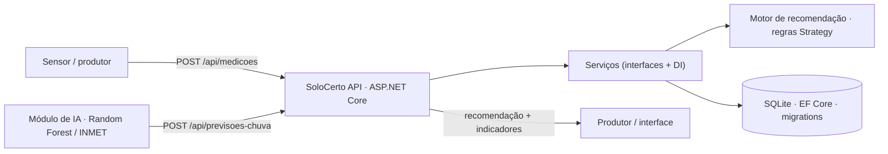

# 🌱 SoloCerto — API de Apoio à Irrigação Inteligente

**Global Solution FIAP 2026.2 · CitizenTech · C# Software Development**

> Apoia pequenos produtores rurais no uso consciente da água, combinando a umidade medida no solo, a previsão de chuva do módulo de IA e regras de negócio que recomendam **quando irrigar e quando esperar a chuva**.

## 1. Equipe

| Integrante                         | RM         |
| ---------------------------------- | ---------- |
| **Igor Brunelli Ralo**             | **555035** |
| **José Antonio Kretzer Rodriguez** | **555523** |
| **Victor Mattenhauer Lopes Capp**  | **555753** |

## 2. Ficha da CitizenTech

| Item                                     | Descrição                                                                                                                                                                     |
| ---------------------------------------- | ----------------------------------------------------------------------------------------------------------------------------------------------------------------------------- |
| **Nome**                                 | SoloCerto                                                                                                                                                                     |
| **Local de referência**                  | Campinas (SP) e região; o projeto não está restrito a um bairro específico                                                                                                    |
| **Cidadão beneficiado**                  | Pequenos produtores rurais que precisam decidir quando irrigar suas plantações                                                                                                |
| **Problema**                             | Irrigar sem considerar a umidade real do solo e a possibilidade de chuva pode desperdiçar água; adiar a irrigação sem informação também pode prejudicar o cultivo             |
| **Solução proposta**                     | Centralizar o cadastro das áreas de cultivo, registrar umidade do solo, apresentar informações sobre chuva e oferecer recomendações de irrigação                              |
| **Parte desenvolvida neste repositório** | Backend REST em C#/.NET: cadastro, medições de umidade, recepção das previsões de chuva da IA, motor de recomendação de irrigação e indicadores |
| **Parte de IA**                          | Modelo de classificação de chuva nas próximas 24 horas, desenvolvido em repositório separado                                                                                  |
| **Indicador de impacto futuro**          | Quantidade e proporção de recomendações que permitam evitar irrigações potencialmente desnecessárias, a serem avaliadas em testes de uso                                      |
| **ODS relacionados**                     | ODS 2 — Fome Zero e Agricultura Sustentável; ODS 9 — Indústria, Inovação e Infraestrutura; ODS 10 — Redução das Desigualdades; ODS 13 — Ação Contra a Mudança Global do Clima |

## 3. O problema e a proposta

A irrigação é essencial para a produção agrícola, mas decisões tomadas sem informações suficientes podem resultar em dois problemas: **uso desnecessário de água** ou **falta de irrigação no momento adequado**.

O **SoloCerto** propõe uma ferramenta de apoio à decisão. A ideia é reunir dados sobre o produtor e sua área de cultivo, acompanhar a umidade do solo e considerar previsões de chuva antes de recomendar uma ação.

**Exemplo de uso:**

1. Um agricultor cadastra sua área de cultivo.
2. O sistema recebe ou registra uma medição de umidade do solo.
3. Uma previsão de chuva informa a chance de precipitação nas próximas 24 horas.
4. Uma regra de negócio analisa a situação e apresenta uma recomendação compreensível ao agricultor.
5. O histórico de medições e recomendações fica disponível para consulta.

A recomendação será **orientativa**, não um comando automático de irrigação. A umidade crítica do solo deverá ter prioridade sobre o alerta de chuva, e os parâmetros deverão considerar as características do cultivo.

## 4. Como a solução funciona

1. O agricultor é cadastrado com suas **plantações**. Cada plantação tem a faixa de umidade adequada para a cultura: a **umidade crítica** (abaixo dela há estresse hídrico) e a **umidade ideal**.
2. O **módulo de IA** envia a probabilidade de chuva ≥ 1 mm nas próximas 24 h (`POST /api/previsoes-chuva`).
3. Um sensor ou o próprio produtor registra a **umidade do solo** (`POST /api/medicoes`).
4. Na mesma resposta, a API devolve a **recomendação de irrigação**, com uma mensagem simples para o produtor e a justificativa técnica.
5. Histórico, situação atual e **indicadores de impacto** ficam disponíveis para consulta.



### Regras de recomendação (avaliadas nesta ordem de prioridade)

| Prioridade | Regra | Situação | Recomendação |
|---|---|---|---|
| 10 | `RegraMedicaoIndisponivel` | Sem medição ou medição com mais de 24 h | **Reavaliar** |
| 20 | `RegraUmidadeCritica` | Umidade abaixo da crítica, **mesmo com chuva prevista** | **IrrigacaoPrioritaria** |
| 30 | `RegraChuvaPrevista` | Umidade abaixo do ideal e chance de chuva ≥ 60% | **AguardarChuva** (irrigação evitada) |
| 40 | `RegraUmidadeBaixa` | Umidade abaixo do ideal e sem chuva provável | **IrrigarHoje** |
| 50 | `RegraUmidadeAdequada` | Umidade na faixa adequada | **NaoIrrigar** |

O limiar de chuva (0,6) e a validade da medição (24 h) ficam na seção `Irrigacao` do `appsettings.json`. A previsão só é considerada dentro da sua janela de 24 horas.

### Indicador de impacto
`GET /api/indicadores` calcula, entre as situações em que o solo estava abaixo do ideal (sem ser crítico), **quantas % a chuva prevista tornou a irrigação desnecessária**. Também traz recomendações por tipo, umidade média por cultura, área monitorada e plantações em situação crítica.

## 5. Conceitos da disciplina aplicados

| Conteúdo | Onde está no código |
|---|---|
| **POO: herança e abstração** | `Models/EntidadeBase.cs` (classe abstrata de todas as entidades) · `Services/Regras/RegrasIrrigacao.cs` (`RegraIrrigacaoBase` abstrata e 5 regras concretas) |
| **POO: encapsulamento** | Entidades com `private set`, construtores que validam e métodos de negócio (`Plantacao.Atualizar`, `ClassificarUmidade`, `MedicaoSolo.EstaDesatualizada`, `PrevisaoChuva.EstaVigente`). Coleções expostas como `IReadOnlyCollection` |
| **POO: polimorfismo** | O `MotorRecomendacao` trata todas as regras como `IRegraIrrigacao` e chama `SeAplica`/`Avaliar` sem conhecer a classe concreta (padrão **Strategy**). Uma regra nova entra sem alterar o motor (teste `Nova_regra_entra_sem_alterar_o_motor`) |
| **Interfaces** | `Interfaces/IServicos.cs` (6 serviços) e `Interfaces/IRegraIrrigacao.cs` |
| **Injeção de dependência** | `Program.cs` registra serviços (`AddScoped`), regras e motor (`AddSingleton`), `TimeProvider` e opções (`IOptions<ParametrosIrrigacao>`). Controllers e serviços recebem dependências por construtor primário |
| **Web API REST** | 6 controllers, verbos GET/POST/PUT/DELETE, `201 Created` com `Location`, `204 No Content`, filtros por query string e erros no padrão **ProblemDetails (RFC 7807)** via `Infra/TratadorDeErros.cs` |
| **Entity Framework Core** | `AppDbContext`, configurações Fluent em `Data/Configurations` (tabelas, tamanhos, índices, cascata, enums como texto), conversores, 2 migrations e migração automática na inicialização |
| **LINQ** | Filtros, ordenações, projeções em DTO e agregações executadas no banco: `GroupBy` + `Count`/`Average`/`Min`/`Max` em `IndicadorService` e `PlantacaoService.ObterHistoricoAsync` |
| **Programação assíncrona** | Todo o acesso a dados com `async/await` (`ToListAsync`, `FirstOrDefaultAsync`, `SaveChangesAsync`, `CountAsync`…) e `CancellationToken` propagado do controller ao banco |
| **Testes unitários** | `tests/SoloCerto.Tests`: 42 testes (entidades, motor de regras, serviços com SQLite em memória e integração HTTP com `WebApplicationFactory`) |
| **Qualidade** | DTOs separados das entidades, validação em duas camadas (DataAnnotations na entrada e regras na entidade), mensagens em português, `TimeProvider` para testar datas, um controller por arquivo, comentários XML que viram documentação |

## 6. Integração com o módulo de Machine Learning

O trabalho de Inteligência Artificial do SoloCerto foi desenvolvido separadamente, com **dados meteorológicos reais do INMET**, referentes à estação de **Bragança Paulista (SP)**, de **2023 a 2025**.

O modelo utiliza **Random Forest** para estimar se ocorrerá chuva de **pelo menos 1 mm nas 24 horas seguintes**, considerando informações disponíveis às 6h. No teste de 2025, o modelo selecionado obteve **F1 da classe chuva de 0,561** e **AUC-ROC de 0,807**.

Repositório: **[SoloCerto — IA & Machine Learning](https://github.com/igguin/solocerto-ml)**.

**Como a integração funciona nesta API:** o modelo roda no repositório de IA e publica o resultado em `POST /api/previsoes-chuva` (`plantacaoId`, `probabilidade` de 0 a 1, `validaAPartirDe`, `fonte`). A API guarda a previsão e o motor de regras usa a previsão vigente de cada plantação. A chamada automática do modelo para este endpoint ainda é feita fora da API (por script ou agendamento no projeto de IA). Para demonstração, a previsão também pode ser enviada manualmente.

## 7. Endpoints

Documentação interativa (Scalar): **`http://localhost:5185/scalar/v1`** (a raiz `/` redireciona para ela). Especificação OpenAPI: `http://localhost:5185/openapi/v1.json`.

| Método | Rota | Finalidade |
|---|---|---|
| GET | `/api/agricultores?cidade=` | Lista agricultores (filtro opcional por cidade) |
| GET | `/api/agricultores/{id}` | Consulta agricultor |
| GET | `/api/agricultores/{id}/plantacoes` | Plantações do agricultor |
| POST | `/api/agricultores` | Cadastra agricultor |
| PUT | `/api/agricultores/{id}` | Atualiza agricultor |
| DELETE | `/api/agricultores/{id}` | Exclui agricultor (cascata) |
| GET | `/api/plantacoes?agricultorId=&cultura=` | Lista plantações |
| GET | `/api/plantacoes/{id}` | Consulta plantação |
| GET | `/api/plantacoes/{id}/situacao` | Última medição, previsão vigente e última recomendação |
| GET | `/api/plantacoes/{id}/historico?dias=30` | Histórico com média, mínima e máxima |
| POST | `/api/plantacoes` | Cadastra plantação |
| PUT | `/api/plantacoes/{id}` | Atualiza plantação |
| DELETE | `/api/plantacoes/{id}` | Exclui plantação |
| POST | `/api/medicoes` | Registra medição **e devolve a recomendação** |
| GET | `/api/medicoes?plantacaoId=&desde=&ate=` | Lista medições |
| POST | `/api/previsoes-chuva` | Recebe a previsão do módulo de IA |
| GET | `/api/previsoes-chuva?plantacaoId=` | Lista previsões |
| POST | `/api/recomendacoes/avaliar/{plantacaoId}` | Reavalia a plantação agora |
| GET | `/api/recomendacoes?plantacaoId=&tipo=` | Lista recomendações |
| GET | `/api/indicadores` | Indicadores de impacto |

## 8. Como executar

**Pré-requisito:** [.NET SDK 10](https://dotnet.microsoft.com/download).

```bash
git clone https://github.com/igguin/solocerto-api.git
cd solocerto-api
dotnet run --project SoloCerto.Api.csproj
```

Abra **http://localhost:5185** no navegador para ver a documentação Scalar e testar os endpoints.

- O banco `solocerto.db` (SQLite) é criado e atualizado **automaticamente pelas migrations** na primeira execução. Não é preciso rodar `dotnet ef database update`, mas o comando também funciona.
- Com o banco vazio, a API carrega **dados fictícios de demonstração** (2 agricultores e 3 plantações). Para desligar, defina `SoloCerto:CarregarDadosDemonstracao` como `false` no `appsettings.json`.
- O arquivo `SoloCerto.Api.http` tem requisições prontas para o VS Code (REST Client) ou o Visual Studio.

**Testes automatizados:**

```bash
dotnet test SoloCerto.slnx
```

**Criar uma nova migration (opcional):**

```bash
dotnet tool install --global dotnet-ef --version 10.0.15
dotnet ef migrations add NomeDaMigration
```

## 9. Estrutura do projeto

```text
solocerto-api/
├── Controllers/        # 6 controllers REST (um por arquivo)
├── DTOs/               # Requests (com validação), Responses e mapeamentos
├── Data/
│   ├── AppDbContext.cs           # DbSets e convenções (decimal→REAL, datas em UTC)
│   ├── Configurations/           # Mapeamento Fluent de cada entidade
│   └── DadosDemonstracao.cs      # Seed fictício (só com o banco vazio)
├── Infra/TratadorDeErros.cs      # Exceções de domínio → ProblemDetails
├── Interfaces/         # Contratos dos serviços e das regras
├── Migrations/         # InitialCreate + DominioIrrigacao
├── Models/             # Entidades de domínio (POO) e enums
├── Services/
│   ├── Regras/                   # Regras de irrigação (Strategy)
│   ├── MotorRecomendacao.cs
│   └── *Service.cs               # Regras de aplicação + consultas LINQ
├── tests/SoloCerto.Tests/        # Testes xUnit
├── evidencias/         # Requisições e respostas reais, prints do Scalar, OpenAPI, resultado dos testes
├── Program.cs          # DI, pipeline, OpenAPI/Scalar, migrations
└── SoloCerto.slnx      # Solução (API + testes)
```

## 10. Evidências

Na pasta [`evidencias/`](evidencias):

- [`requisicoes-e-respostas.md`](evidencias/requisicoes-e-respostas.md): 20 chamadas reais à API (cadastros, PUT, medições que geram cada tipo de recomendação, histórico, indicadores, erros 400/404 e exclusão em cascata), com o JSON de cada resposta.
- `scalar-documentacao.png`, `scalar-post-medicoes.png`, `scalar-indicadores.png`: documentação interativa gerada automaticamente.
- [`openapi-v1.json`](evidencias/openapi-v1.json): especificação OpenAPI exportada.
- [`testes-automatizados.txt`](evidencias/testes-automatizados.txt): resultado dos 42 testes.

## 11. Repositórios e contexto acadêmico

- **C# / backend:** [github.com/igguin/solocerto-api](https://github.com/igguin/solocerto-api)
- **Inteligência Artificial & Machine Learning:** [github.com/igguin/solocerto-ml](https://github.com/igguin/solocerto-ml)
- **Instituição:** FIAP · Global Solution 2026.2, proposta CitizenTech.

O SoloCerto é um **protótipo acadêmico**. Os limites de umidade e as recomendações são orientativos e não substituem uma avaliação agronômica.
